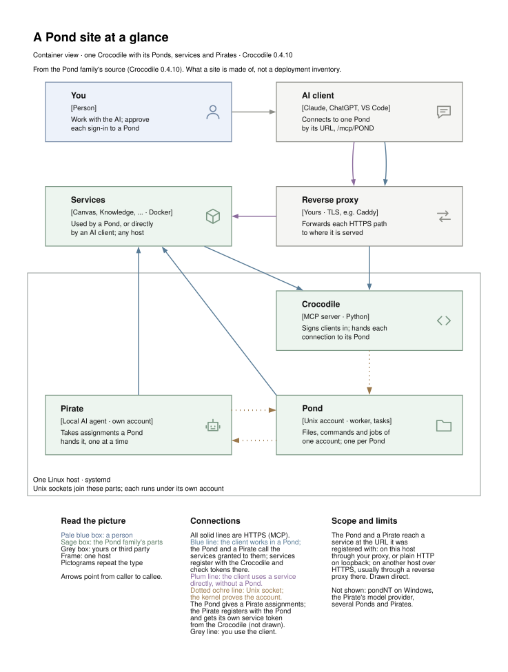
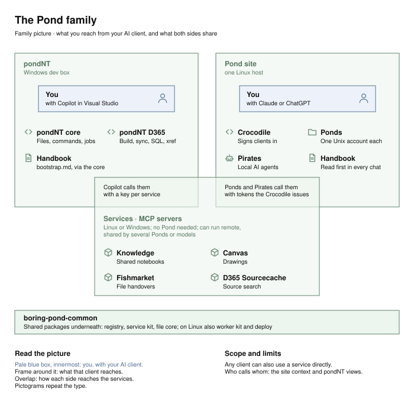

# The Boring Pond

**Give an AI assistant a real workspace on your own machine: files, commands,
long-running jobs and a few shared tools, behind your own sign-in.**

An AI client (Claude, ChatGPT, VS Code Copilot) connects over MCP (the Model
Context Protocol, the way these clients call tools) to the **Crocodile**, which hands it a **Pond**: a Unix account with its files and
commands, nothing more. Services (a drawing board, a notebook, file handovers,
a code index) work beside it or on their own; **Pirates** are local agents the
Pond can hand work to. House names are explained in the [glossary](docs/glossary.md).

Choose the part that fits your machine:

- **Linux workspace:** a server with systemd, plus a domain and TLS reverse
  proxy for clients connecting from the cloud. Start with
  [getting started](docs/getting-started.md).
- **Windows D365 development:** [pondNT](https://github.com/the-boring-crocodile/boring-pondnt/blob/main/README.md)
  gives Visual Studio Copilot local tools on the development box.
- **One shared tool:** use [a service](https://github.com/the-boring-crocodile/boring-services/blob/main/README.md)
  independently. You do not need to install a whole Pond.

## All of it is AI

Say it once, up front: all of it — the code, the tests, the diagrams and
these docs — was written by AI (OpenAI's models and Anthropic's Claude),
working in Ponds: accounts on Wald's machine, exactly like the ones this
project gives you. Wald decided what to build, tested it, ran it and had the
last word; he holds root, and nothing that needed it ran without him. The
assistants do the rest and write down what they did.
[Why it exists](docs/story.md) has the decisions and who made them;
[one release, one evening](docs/case-study.md) shows a working day.

<picture>
  <source media="(prefers-color-scheme: dark)" srcset="docs/site-context-dark.svg">
  
</picture>

The Pond is the whole; Crocodile, pondNT, services and Pirates are its
independently usable parts. Every MCP server in the family can sign people in
by itself or trust a Crocodile ([how](https://github.com/the-boring-crocodile/boring-services/blob/main/docs/CONFIGURATION.md)).

<picture>
  <source media="(prefers-color-scheme: dark)" srcset="docs/pond-family-dark.svg">
  
</picture>

| Repository | Responsibility |
|---|---|
| [boring-crocodile](https://github.com/the-boring-crocodile/boring-crocodile/blob/main/README.md) | Linux workspace host, commands, jobs and service authority |
| [boring-pondnt](https://github.com/the-boring-crocodile/boring-pondnt/blob/main/README.md) | Windows host, core tools and D365 integration |
| [boring-services](https://github.com/the-boring-crocodile/boring-services/blob/main/README.md) | Canvas, Knowledge, Sourcecache D365, Fishmarket and the optional Ferry gateway |
| [boring-pirates](https://github.com/the-boring-crocodile/boring-pirates/blob/main/README.md) | Trusted local agent execution |
| [boring-pond-common](https://github.com/the-boring-crocodile/boring-pond-common/blob/main/README.md) | Authoritative shared libraries |
| boring-pond (this repository) | Overview, the story, sample Ponds, the family's shared docs |

## The fine print, up front

A Pond is trusted like a person with an account on your machine: a real
account, not a sandbox, and the account is the boundary
([trust and boundaries](docs/trust.md)). Keep the working state in the Pond's
files so the next conversation can recover it, whichever client you use
([keeping a Pond's memory](docs/in-practice.md#keeping-a-ponds-memory-your-part)).
And root stays with you, unless you give a Pond host administration on
purpose: the AI prepares the command, you read it and press Enter.

## Next to the coding agent you already have

A coding agent in your terminal or editor, or an SSH session into a dev
server, already puts an AI in a repository. A Pond adds what outlasts one
session and one client:

- **One server identity for every client.** Claude in the browser, ChatGPT
  and Claude Code on a laptop each sign in to the same Pond and land in the
  same Unix account, home and handbook. Whichever you open tomorrow reads
  what the other one saved today.
- **Work that outlives the conversation.** A test suite or a build started
  as a job keeps running when the chat ends; the next conversation finds it
  with `job_list` and reads its result while the result is kept.
- **Shared services.** A drawing pushed to Canvas opens in your browser; a
  lesson one Pond writes into Knowledge, another Pond finds.
- **Independent workers.** Separate work or people get separate Ponds, each
  its own account. A Pirate takes an assignment on another model, local or
  hosted, while the conversation carries on.

If you work in one repository on one machine and a session's memory is
enough, the agent alone is simpler. The two combine: Claude Code connects to
a Pond like any MCP server ([getting started](docs/getting-started.md#81-claude)).

## Two Ponds to start from

A Pond's handbook is what the AI reads at the start of every conversation.
It is memory, but mostly it is discipline: your engineering principles,
there from the first line of every session instead of rediscovered halfway
through ([why](docs/story.md#memory-is-the-means-discipline-is-the-point)). A
new Pond gets a short, neutral starter, or one of two complete handbooks
written from what worked for us:

- **The Engineer**: code, systems, releases. Builds things that hold, says
  plainly what it has not checked, and keeps the agreement from drifting.
- **The Consultant**: research and concepts. Looks until it sees clearly,
  then answers once; every finding has a place, a source and a date.

Inside, each handbook has a character of its own (the Engineer's is the
Steady Beaver, the Consultant's the Tidy Kingfisher), which a Pond keeps or
renames as it becomes yours.

Install one when you create the Pond: [sample Ponds](handbooks/README.md),
and the whole walk from download to a first conversation in
[getting started](docs/getting-started.md).

## Read on

- **Start:** [getting started](docs/getting-started.md): one Pond, one
  client and a recovered handoff first, then two Ponds step by step.
- **Run it:** [installation](docs/installation.md),
  [updating](docs/updating.md), [client setup](docs/clients.md), and the [example site](docs/example-site.md)
  whose names every example uses; [our site](docs/our-site.md) is a real one.
- **Understand it:** [architecture](docs/architecture.md),
  [trust and boundaries](docs/trust.md), the [glossary](docs/glossary.md).
- **Why and how it was built:** [the story](docs/story.md),
  [in practice](docs/in-practice.md), and
  [one release, one evening](docs/case-study.md).
- **Work on it:** [development](docs/development.md); every Linux part
  installs, updates and rolls back with one engine,
  [boring-deploy](https://github.com/the-boring-crocodile/boring-pond-common/blob/main/packages/boring-deploy/README.md).
- **Credits:** [third-party software](docs/third-party.md).

## Licence

Code under the GNU AGPL, version 3 or later; documentation under CC BY-SA
4.0. The sample handbooks (`handbooks/`) and the diagram template
(`guides/boring-diagrams/TEMPLATE.dot`) are public domain (CC0). What you
make with the tools is yours. Details and the exact terms:
[COPYING.md](COPYING.md).

Boring is a promise: architecture that still makes sense at two in the
morning, five months from now.

<^==>
