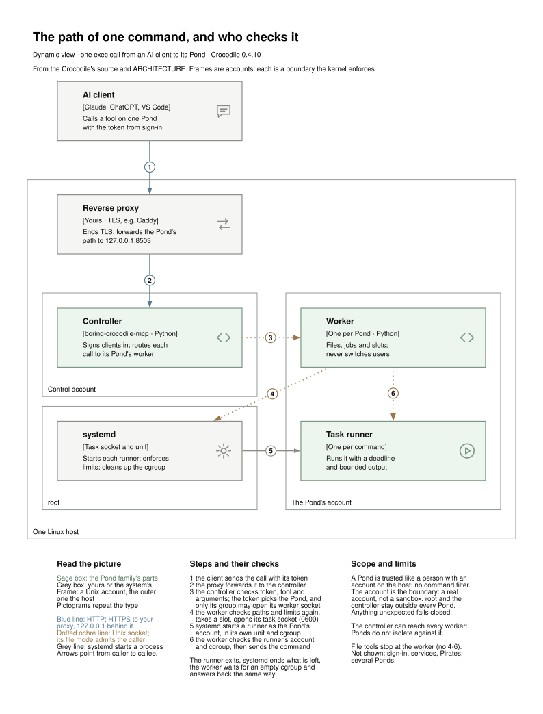
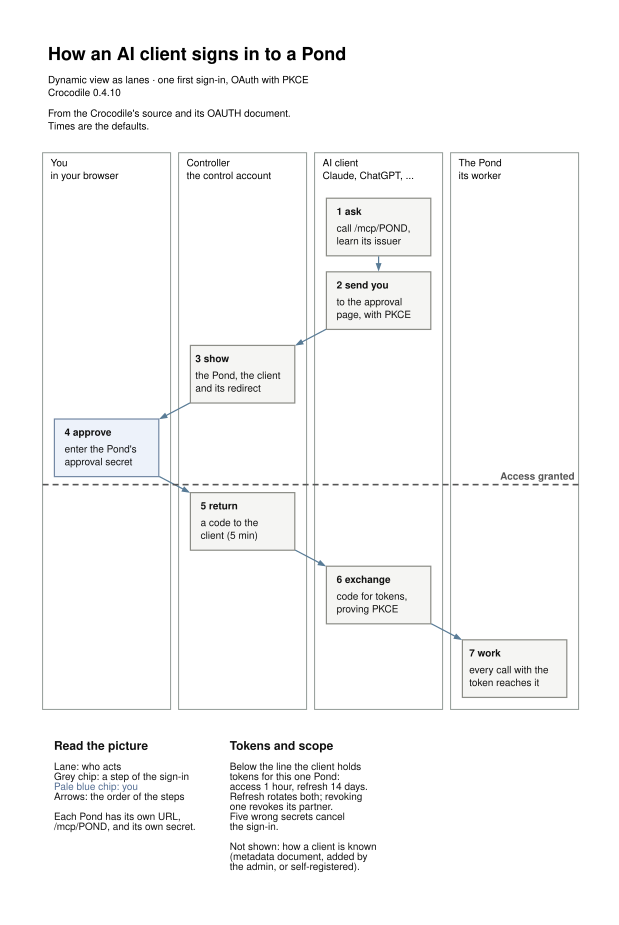

# Architecture

The family in one picture is on the [front page](../README.md): you and your
AI client, the parts that client reaches, and the services both sides share.
This page goes one level down: the path of one command through a Linux site,
and how a client signs in.

The Crocodile is the Linux workspace host; pondNT supplies the Windows core and
D365 tools. Both speak MCP, for different operating systems. Services are MCP
servers usable on their own; Pirates take assignments from a Pond over a Unix
socket. A service owns its caller policy and its data; a Crocodile only
registers, pings and authorizes calls to it.

On a Windows dev box, the recommended setup connects Copilot directly to core
and Knowledge, with the other selected services behind Ferry. This keeps
workspace tools and shared lessons immediately available while specialist
tools are discovered as needed. Ferry routes calls; each backend still owns
its work and data. See [pondNT setup](https://github.com/the-boring-crocodile/boring-pondnt/blob/main/docs/INSTALL.md)
and [the gateway trade-off](https://github.com/the-boring-crocodile/boring-services/blob/main/mcp-ferry/README.md#gateways-optional).

## The path of one command

<picture>
  <source media="(prefers-color-scheme: dark)" srcset="request-path-dark.svg">
  
</picture>

Each frame is a Unix account, and each is a boundary the kernel enforces: a
Pond is trusted like a person with an account on the host, not sandboxed
inside it. The controller can reach every worker, so Ponds do not isolate
against a compromised controller. Who is trusted with what, and what follows
when something goes wrong: [trust and boundaries](trust.md). The full list of
checks is in [Crocodile's architecture](https://github.com/the-boring-crocodile/boring-crocodile/blob/main/docs/ARCHITECTURE.md).

## Signing in

<picture>
  <source media="(prefers-color-scheme: dark)" srcset="sign-in-dark.svg">
  
</picture>

A client signs in once per Pond, with OAuth and PKCE. Possession of the
Pond's approval secret is what authorizes it; the tokens it gets work only
on that Pond's URL. Lifetimes, storage and the ways a client becomes known
are in [Crocodile's OAuth guide](https://github.com/the-boring-crocodile/boring-crocodile/blob/main/docs/OAUTH.md).

## Packages

Pond Common owns file-core, registry, service-kit, worker-kit and the shared
Linux deployment engine.
Crocodile uses the first four at runtime; Pirates uses file-core, registry and worker-kit;
pondNT uses file-core, registry and service-kit; the services use registry and
service-kit. Worker-kit is Linux-specific. Common does not import applications.
Crocodile's task-state package has one maintained consumer and remains there.

Repository, package, image and deployment boundaries are distinct. Services
remain one repository with four specialist services plus Ferry, each with an
independently buildable image. Common remains one repository with independently
versioned packages. This lets a consumer adopt a shared-package change without
forcing every application onto one release; the [development guide](development.md)
explains how frozen refs and wheel hashes keep those choices reproducible.
